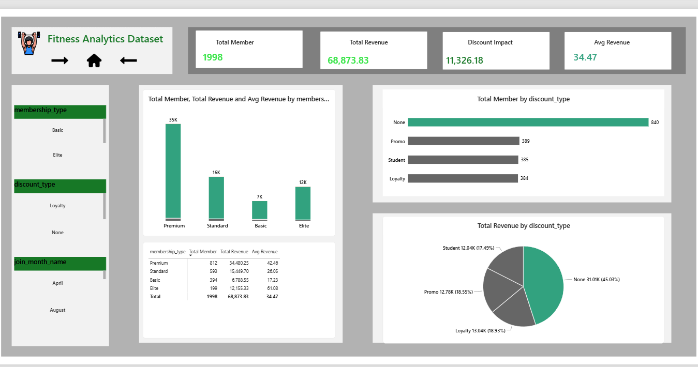

# Fitness Analytics Dashboard - Power BI

## 📊 Overview
Analyzed fitness membership data of 1,998 members to track revenue, discount impact, and membership performance. Built in Power BI with interactive filters.

## 🖼️ Dashboard

## 📈 KPIs
- Total Members: 1,998
- Total Revenue: 68,873.83
- Discount Impact: 11,326.18
- Avg Revenue: 34.47

## 📊 Visuals Breakdown
- Total Member, Revenue & Avg Revenue by Membership Type (Premium, Standard, Basic, Elite)
- Total Member by Discount Type (None, Promo, Student, Loyalty)
- Total Revenue by Discount Type (Pie Chart)
- Table breakdown by membership_type

## 💡 Key Insights
- Premium members generate highest revenue (23K+) despite being fewer
- "None" discount type has highest member count (1600+)
- Student & Loyalty discounts drive ~17% & ~10% of revenue
- Elite membership shows strong avg revenue per member

## 🛠️ Tools Used
Power BI | DAX | Data Modeling | Data Visualization | Slicers (Membership, Discount, Month)

## 📁 Files
- Fitness_Analytics.pbix - Power BI file
- dashboard.png - Dashboard preview
